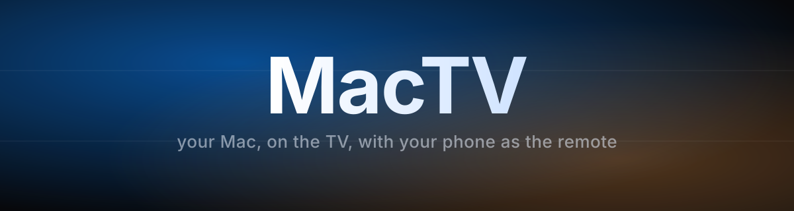

<p align="center">
  
</p>

<p align="center">
  
  
  
  
</p>

Turns the MacBook connected to the TV into something like an Apple TV: a
giant interface navigable with arrow keys, your phone as the remote, and
every app in its own desktop at full screen.

No dependencies: just Python 3 (already on macOS) and the browser you have.

<p align="center">
  
</p>

## Index

- [Why](#why)
- [Installation](#installation)
- [Starting it up](#starting-it-up)
- [Permissions (first time only)](#permissions-first-time-only)
- [The TV interface](#the-tv-interface)
- [Each app gets its own desktop](#each-app-gets-its-own-desktop)
- [The remote](#the-remote)
- [The sleep timer](#the-sleep-timer)
- [Sound and vibration](#sound-and-vibration)
- [Customizing](#customizing)
- [How it fits together](#how-it-fits-together)
- [Known limitations](#known-limitations)
- [License](#license)

## Why

Hooking a Mac up to the TV leaves you with a tiny mouse pointer from a couch
three meters away. MacTV replaces that with:

- An **app interface** built to be seen and navigated from the couch, with
  arrow keys instead of a mouse.
- Your **phone as a remote**, laid out like the Apple TV remote (touch
  surface, d-pad, OK, volume...).
- Every app you open lands on **its own desktop at full screen**, and you
  can get back to MacTV without closing it.

Works with Netflix, YouTube, Disney+, Twitch, Stremio, Spotify and, in
general, any app on the Mac.

## Installation

```bash
git clone https://github.com/alexcalatyd/MacTV.git
cd MacTV
./mactv
```

Nothing else to install: it uses the system's own Python 3.

If you want to launch it from anywhere by typing `mactv`, add an alias to
your `~/.zshrc` pointing at the script:

```bash
alias mactv="/path/where/you/cloned/MacTV/mactv"
```

## Starting it up

```bash
mactv
```

The terminal prints the remote's address:

```
TV     ->  http://localhost:8777/
Remote ->  http://192.168.1.XXX:8777/remote
```

Open that second URL in Safari on your iPhone (same WiFi) and tap
**Share → Add to Home Screen**: it stays as a remote app, full screen and
with no browser bars.

`Ctrl+C` to quit. `mactv --no-ui` starts just the remote server.

## Permissions (first time only)

**System Settings → Privacy & Security → Accessibility** → enable the
terminal app you're launching it from (Ghostty, Terminal, iTerm…). MacTV
sends real keystrokes and inspects windows; without that permission it does
nothing. If it's missing, MacTV warns you on startup and opens the panel.

## The TV interface

- **Watch** — the pinned apps: Netflix, YouTube, Disney+ and Twitch (your
  Brave web apps), plus Stremio and Spotify, which open the native app. Any
  new web app you create in Brave shows up here on its own.
- **Apps** — everything else, with **Sleep** (the moon) as the first tile.
- Arrow keys to move around, `OK` opens, `esc` goes back. Typing filters on
  the fly and the filter clears itself after 5 seconds.

Everything — header, titles, the first tile in each row, and the footer — is
aligned to the same margin, and the whole block centers vertically when
there's room to spare.

The focused tile rises and the rest recede. The background light **comes
from the icon you have focused**: MacTV pulls its dominant color and uses it
to tint the room, which shifts to follow the focus. That way you can tell
where you are from across the room without reading anything.

## Each app gets its own desktop

MacTV **also** launches full screen, on its own desktop, and whatever you
open from it lands **full screen on a brand-new desktop**. The **MacTV**
button on the remote brings you back to its desktop without closing
anything, and the app stays right there.

Getting here took work, because macOS puts up four barriers and all four
have to be worked around. They're documented here so the code doesn't break
when someone touches it:

1. **The browser's web apps aren't their own processes.** Netflix, YouTube,
   Disney+ and Twitch used to be windows of the user's own Brave, just like
   MacTV. Asking for "Brave's front window" grabbed a random tab. That's why
   MacTV no longer uses those shortcuts: it reads each one's URL (the
   `CrAppModeShortcutURL` from its Info.plist) and **opens each app in its
   own browser instance**, with its own profile under `~/.mactv/apps/`.
2. **`--start-fullscreen` is only honored by macOS if launched from the
   normal desktop.** From a full-screen desktop it's silently ignored. Since
   MacTV lives on its own full-screen desktop, before opening any app it
   **steps out to the normal desktop** (by activating the Finder) and
   launches from there. The same applies to native apps, because full
   screen is set via accessibility and that only works on the active
   desktop.
3. **Accessibility can only see windows on the active desktop.** It can't
   touch a window sitting on another desktop, so tracking is done with
   CoreGraphics' window list, and the result is confirmed by **measuring**
   the frame.
4. **macOS activates applications, not processes.** Both browser instances
   are the same application, and the ctrl+arrow shortcuts for switching
   desktops are disabled. To **get back** to MacTV, since its desktop is
   full screen and belongs only to it with a single window, activating its
   process can't lead anywhere else; the only thing that gets in the way is
   coming from a full-screen app, because macOS stays on it, so the app gets
   **hidden** first (hiding a full-screen app returns you to the previous
   desktop). If MacTV ever ends up without full screen, the older path is
   used instead: activate the Finder (always on the normal desktop), raise
   MacTV's window, and give it back focus with a click on its title bar.

Measured on the machine: the app reaches full screen in ~1 s and coming back
takes ~1.5 s, with the app still alive.

**The cost:** each web app uses its own browser profile. MacTV copies your
Brave cookies over the first time, so you usually don't have to log in
again; if one does ask, it's just once and it's remembered after that.

Can be turned off in `~/.mactv/config.json` (`"fullscreen"`, `"return_home"`).

## The remote

A single screen, no tabs, laid out like the Apple TV remote:

<p align="center">
  
</p>

| Zone | What it does |
|------|----------|
| **Touch surface** | Swipe moves the pointer, tap clicks, two fingers scroll. |
| **D-pad** | Navigate. Hold an arrow to repeat it. |
| **OK** | Tap = select. Drag without releasing = scroll joystick. |
| **MacTV** | Returns to MacTV **without closing** whatever you were using. |
| **Close** | Quits the frontmost app (⌘Q). Closing it returns you to MacTV. |
| **Back** | `esc`. |
| **Play / Pause** | Spacebar. |
| **Volume** | Rocker with + and −, and mute in the middle. |

Sized accounting for the safe areas: fits entirely without scrolling,
checked at 0 px of overflow on iPhone SE, 13 Pro and 15 Pro Max. Every
button clears the minimum touch target (58 px on the smallest screen) and
every control has a distinct silhouette — wide pill, narrow pill, tall
rocker — so you can find it with your thumb without looking. If the
connection to the Mac drops, a warning shows up at the top; while
everything's fine, nothing shows at all.

### Sensitivity

The pointer **accelerates based on how fast you move your finger**, like the
Mac's trackpad: slow is precise, fast crosses the screen in one go. OK's
joystick does the same thing with distance: gentle near the center, fast at
the edge.

The parameters sit at the top of `web/remote.html`'s script, in `ACC` and
`STICK`, in case you want more or less:

```js
const ACC   = { base:1.0, k:3.6, exp:1.15, max:12, smooth:.45 };
const STICK = { dead:9, span:80, exp:2.0, max:58, tick:55 };
```

Raise `ACC.k` or `ACC.max` to make it run faster; lower `ACC.base` for more
precision on slow movements.

### The keyboard shows up by itself

MacTV checks whether the app in front of you has focus on a text field (a
Netflix search box, say) and the remote pops up a notice and opens the
keyboard.

An iOS limit: Safari only lets the keyboard open inside a gesture, never
from a timer. If it gets blocked, it opens on **the next tap anywhere on the
remote**. It's still a tap, but it isn't fully automatic and it can't be.

## The sleep timer

The moon tile opens 5, 10, 15, 30, 45 and 60 minutes. The timer launches as
a separate process, so it keeps running even if you close MacTV or the
terminal. Picking a different time replaces the previous one. "Cancel the
timer" only shows up if one is running. The countdown shows in the TV's
header and on the moon tile itself.

## Sound and vibration

Both screens share `web/ui.js`: a small synthesizer that builds every cue on
the fly, with no audio files. These aren't bells or beeps — a bell's high
inharmonic partials sound like a cheap notification — but three short, warm
layers stacked together:

1. **Transient.** Narrow-band noise, 10–30 ms, centered in the mids
   (0.4–2 kHz). It's the articulation: the wooden "tock". Filtered from
   above instead of the middle, it would whistle.
2. **Body.** A near-pure sine or triangle that decays fast, usually with a
   small glissando. Dropping the pitch 5–10% while it decays is what turns a
   beep into a "pop" with some give in it.
3. **Weight.** A low sine at 70–150 Hz, very short. You don't hear it as a
   note: you feel it. Without it the sound floats.

On top of that, a dark 180 ms reverb tail with a per-voice send so nothing
sounds dry, and gentle saturation (tanh, slope 1 at the origin) on the
master that glues the layers together and acts as a ceiling.

The intervals are just fifths and fourths, and the register is low on
purpose: navigating alternates between two nearly identical pitches, opening
rises a fourth and stays up there, confirming rises a fifth with a tail,
going back and closing drop, and hitting an edge is the same muted, low
wood. They're still graded: navigating and the repeat while holding are a
whisper, confirming is the loudest of the set.

To hear them all in a row there's a test page at
`http://<mac-ip>:8777/sounds`, with one cue per button.

On the phone, each cue also carries its own vibration: a light brush to
navigate, a solid hit to confirm. It works via `navigator.vibrate`
(Android, Chrome). **iOS Safari doesn't implement it**: there, MacTV falls
back to toggling an `<input switch>` control, which since Safari 17.4 fires
a system tick. It's a fixed tick, can't be graded, and if the browser
doesn't cooperate, nothing happens at all.

Can be muted from the console with `MacTV.mute(true)` or have vibration
turned off with `MacTV.haptics(false)`; it's saved in the browser.

Both screens respect `prefers-reduced-motion`: with that preference on,
there's no entrance animation or transitions.

## Customizing

Everything lives in `~/.mactv/config.json`:

```json
{
  "version": 3,
  "featured": ["Netflix", "YouTube", "Disney+", "Twitch", "Stremio", "Spotify"],
  "hidden": ["Mail", "Notes", "…"],
  "sleep_options": [5, 10, 15, 30, 45, 60],
  "fullscreen": true,
  "return_home": true
}
```

Delete the file and it regenerates. Port: `MACTV_PORT=9000 mactv`. If you
install a new app, delete `~/.mactv/icons` and restart so it picks up its
icon.

### The remote's address

Down in the corner of the TV, the remote's address shows up with a pencil
icon. It's a button: reachable with the arrow keys (it's at the very
bottom) or tapped from the phone's trackpad. Inside, you can type it in by
hand, pick one of the addresses the Mac detects, or go back to automatic
detection. It's saved as `remote_host` inside `config.json`.

When it opens, the text field is already focused, so **the phone pulls up
its own keyboard** and you can type the IP from the couch.

## How it fits together

The remote **doesn't control MacTV's interface**: it injects real keystrokes
into macOS. That's why the arrow keys work the same way inside the launcher
as they do inside Netflix, with no modes or context switches.

- `mactv.py` — server + event injection (CoreGraphics via `ctypes`) +
  window tracking + timer.
- `web/launcher.html` — the TV. A page that listens for arrow keys.
- `web/remote.html` — the remote.
- `web/ui.js` — sound and vibration, shared by both.
- `web/sounds.html` — the sound test page (`/sounds`).

Icons are extracted with NSWorkspace and cached under `~/.mactv/icons`. Every
icon in the interface is its own SVG, no emoji.

## Tip for the TV

In **System Settings → Displays**, with the TV connected, pick a low scaled
resolution (1280×720). The whole system looks twice the size from the
couch.

## Known limitations

- Play/Pause sends the spacebar, which is what Netflix, YouTube, VLC and
  QuickTime understand. It doesn't control Spotify in the background.
- Watching windows and detecting the text field is done by polling the
  system every second and a half: getting back to MacTV takes a couple of
  seconds.
- Some apps don't support full screen (System Settings, for instance).
  They open normally; MacTV doesn't force it.
- The remote has no password: anyone on your WiFi who knows the URL can
  control the Mac. Fine at home; on a shared network, don't leave it
  running.

## License

MIT — see [LICENSE](LICENSE).
