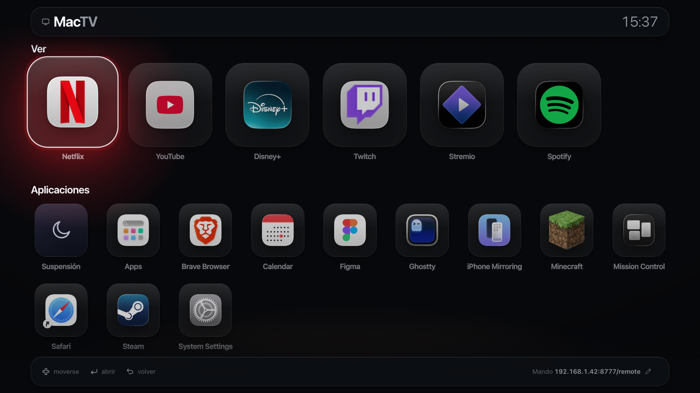
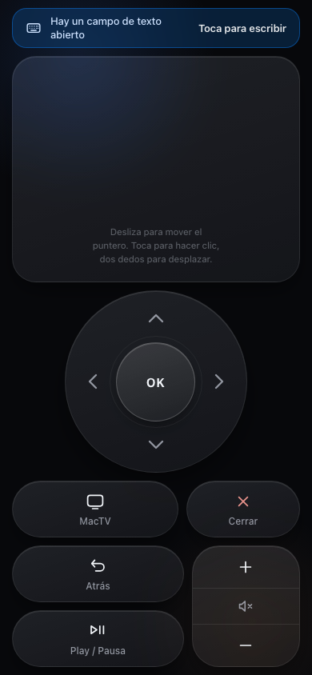

# MacTV

Convierte el MacBook conectado a la tele en algo parecido a un Apple TV: una
interfaz gigante navegable con flechas, el móvil como mando a distancia, y
cada app en su propio escritorio a pantalla completa.

Sin dependencias: solo Python 3 (ya viene en macOS) y el navegador que tienes.

<!--  -->

## Índice

- [Por qué](#por-qué)
- [Instalación](#instalación)
- [Arrancar](#arrancar)
- [Permisos (solo la primera vez)](#permisos-solo-la-primera-vez)
- [La interfaz de la tele](#la-interfaz-de-la-tele)
- [Cada app en su propio escritorio](#cada-app-en-su-propio-escritorio)
- [El mando](#el-mando)
- [El temporizador de suspensión](#el-temporizador-de-suspensión)
- [Sonido y vibración](#sonido-y-vibración)
- [Personalizar](#personalizar)
- [Cómo encaja](#cómo-encaja)
- [Limitaciones conocidas](#limitaciones-conocidas)
- [Licencia](#licencia)

## Por qué

Conectar un Mac a la tele te deja con un ratón diminuto en un sofá a tres
metros de distancia. MacTV reemplaza eso por:

- Una **interfaz de apps** pensada para verse y navegarse desde el sofá, con
  flechas en vez de ratón.
- El **móvil como mando**, con la disposición del mando del Apple TV
  (superficie táctil, cruceta, OK, volumen...).
- Cada app abierta entra en **su propio escritorio a pantalla completa**, y
  puedes volver a MacTV sin cerrarla.

Funciona con Netflix, YouTube, Disney+, Twitch, Stremio, Spotify y, en
general, con cualquier app del Mac.

## Instalación

```bash
git clone https://github.com/Alexxalataaa/mactv.git
cd mactv
./mactv
```

No hay que instalar nada más: usa el Python 3 del sistema.

Si quieres poder lanzarlo desde cualquier sitio escribiendo `mactv`, añade un
alias a tu `~/.zshrc` apuntando al script:

```bash
alias mactv="/ruta/donde/clonaste/mactv/mactv"
```

## Arrancar

```bash
mactv
```

El terminal imprime la dirección del mando:

```
TV     ->  http://localhost:8777/
Movil  ->  http://192.168.1.XXX:8777/remote
```

Abre esa segunda URL en el Safari del iPhone (misma WiFi) y dale a
**Compartir → Añadir a pantalla de inicio**: queda como una app de mando, a
pantalla completa y sin barras.

`Ctrl+C` para salir. `mactv --no-ui` arranca solo el mando.

## Permisos (solo la primera vez)

**Ajustes del Sistema → Privacidad y Seguridad → Accesibilidad** → activa la
app de terminal desde la que lo lanzas (Ghostty, Terminal, iTerm…). MacTV envía
pulsaciones reales y consulta ventanas; sin ese permiso no hace nada. Si falta,
lo avisa al arrancar y abre el panel.

## La interfaz de la tele

- **Ver** — las apps ancladas: Netflix, YouTube, Disney+ y Twitch (tus apps web
  de Brave), más Stremio y Spotify, que abren la app nativa. Cualquier app web
  nueva que crees en Brave aparece aquí sola.
- **Aplicaciones** — el resto, con **Suspensión** (la luna) como primera ficha.
- Flechas para moverse, `OK` abre, `esc` vuelve. Escribir filtra al vuelo y el
  filtro se borra solo a los 5 segundos.

Todo —cabecera, títulos, primera ficha de cada fila y pie— está alineado al
mismo margen, y el bloque se centra en vertical cuando sobra sitio.

La ficha enfocada se eleva y el resto se retira. La luz del fondo **sale del
icono que tienes enfocado**: MacTV le saca el color dominante y lo usa para
teñir la sala, que se desplaza siguiendo al foco. Así se ve desde lejos dónde
estás sin tener que leer nada.

## Cada app en su propio escritorio

MacTV **también** arranca a pantalla completa, en su propio escritorio, y lo
que abres desde él entra a **pantalla completa en otro escritorio nuevo**. Con
el botón **MacTV** del mando vuelves a su escritorio sin cerrar nada, y la app
sigue ahí.

Llegar a esto costó, porque macOS pone cuatro barreras y hay que sortear las
cuatro. Están documentadas aquí para que no se rompa al tocar el código:

1. **Las apps web del navegador no son procesos propios.** Netflix, YouTube,
   Disney+ y Twitch eran ventanas del Brave del usuario, igual que MacTV. Pedir
   "la ventana frontal de Brave" cogía cualquier pestaña al azar. Por eso MacTV
   ya no usa esos accesos directos: lee la URL de cada uno (`CrAppModeShortcutURL`
   de su Info.plist) y **abre cada app en su propia instancia del navegador**,
   con su propio perfil en `~/.mactv/apps/`.
2. **`--start-fullscreen` solo lo aplica macOS si se lanza desde el escritorio
   normal.** Desde un escritorio a pantalla completa lo ignora en silencio. Como
   MacTV vive en su propio escritorio a pantalla completa, antes de abrir
   cualquier app **sale al escritorio normal** (activando el Finder) y lanza
   desde allí. Lo mismo hace falta para las apps nativas, porque la pantalla
   completa se les pone por accesibilidad y eso solo funciona en el escritorio
   activo.
3. **La accesibilidad solo ve las ventanas del escritorio activo.** No sirve
   para tocar una ventana que está en otro escritorio, así que el seguimiento
   se hace con la lista de ventanas de CoreGraphics y el resultado se confirma
   **midiendo** el marco.
4. **macOS activa aplicaciones, no procesos.** Las dos instancias del navegador
   son la misma aplicación, y los atajos ctrl+flecha para cambiar de escritorio
   vienen desactivados. Para **volver** a MacTV, estando a pantalla completa su
   escritorio es solo suyo y tiene una única ventana, así que activar su
   proceso no puede llevar a otro sitio; lo único que estorba es venir de una
   app a pantalla completa, porque macOS se queda en ella, y por eso primero se
   **esconde** la app (esconder una app a pantalla completa devuelve al
   escritorio anterior). Si MacTV se quedase sin pantalla completa se usa el
   camino de antes: activar el Finder (que siempre está en el escritorio
   normal), subir la ventana de MacTV y devolverle el foco con un clic en su
   barra de título.

Medido en la máquina: la app entra a pantalla completa en ~1 s y la vuelta tarda
~1,5 s, con la app viva.

**Precio a pagar:** cada app web usa su propio perfil de navegador. MacTV copia
las cookies de tu Brave la primera vez, así que normalmente no hay que volver a
iniciar sesión; si alguna te la pide, es una vez y se queda guardada.

Se puede desactivar en `~/.mactv/config.json` (`"fullscreen"`, `"return_home"`).

## El mando

Una sola pantalla, sin pestañas, con la disposición del mando del Apple TV:

<!--  -->

| Zona | Qué hace |
|------|----------|
| **Superficie táctil** | Deslizar mueve el ratón, tocar hace clic, dos dedos desplazan. |
| **Cruceta** | Navegar. Mantener pulsada una flecha la repite. |
| **OK** | Tocar = aceptar. Arrastrar sin soltar = joystick de desplazamiento. |
| **MacTV** | Vuelve a MacTV **sin cerrar** lo que estuvieras usando. |
| **Cerrar** | Cierra el programa de delante (⌘Q). Al cerrarse vuelves a MacTV. |
| **Atrás** | `esc`. |
| **Play / Pausa** | Barra espaciadora. |
| **Volumen** | Balancín con + y −, y silencio en el centro. |

Dimensionado contando las áreas seguras: entra entero sin scroll, comprobado a
0 px de desbordamiento en iPhone SE, 13 Pro y 15 Pro Max. Cada botón pasa del
objetivo táctil mínimo (58 px en la pantalla más pequeña) y cada control tiene
una silueta distinta —pastilla ancha, pastilla estrecha, balancín alto— para
encontrarlo con el pulgar sin mirar. Si se corta la conexión con el Mac sale un
aviso arriba; mientras todo va bien, no sale nada.

### Sensibilidad

El puntero **acelera según lo rápido que muevas el dedo**, como el trackpad del
Mac: despacio es preciso, rápido cruza la pantalla de un tirón. El joystick de
OK hace lo mismo con la distancia: suave cerca del centro, rápido en el borde.

Los parámetros están arriba del script de `web/remote.html`, en `ACC` y
`STICK`, por si quieres más o menos:

```js
const ACC   = { base:1.0, k:3.6, exp:1.15, max:12, smooth:.45 };
const STICK = { dead:9, span:80, exp:2.0, max:58, tick:55 };
```

Sube `ACC.k` o `ACC.max` para que corra más; baja `ACC.base` para más precisión
en los movimientos lentos.

### El teclado aparece solo

MacTV mira si la app que tienes delante tiene el foco en un campo de texto (una
búsqueda de Netflix, por ejemplo) y el mando saca un aviso y abre el teclado.

Límite de iOS: Safari solo deja abrir el teclado dentro de un gesto, nunca desde
un temporizador. Si lo bloquea, se abre con **el siguiente toque en cualquier
parte del mando**. Es un toque, pero no es del todo automático y no puede serlo.

## El temporizador de suspensión

La ficha de la luna abre 5, 10, 15, 30, 45 y 60 minutos. El temporizador se
lanza como proceso aparte, así que sigue en pie aunque cierres MacTV o el
terminal. Elegir otro tiempo sustituye el anterior. "Cancelar el temporizador" solo
aparece si hay uno en marcha. La cuenta atrás se ve en la cabecera de la tele y
en la propia ficha de la luna.

## Sonido y vibración

Las dos pantallas comparten `web/ui.js`: un sintetizador pequeño que fabrica
cada señal al vuelo, sin archivos de audio. No son campanas ni pitidos —los
parciales inarmónicos altos de una campana suenan a notificación barata—, sino
tres capas cortas y cálidas apiladas:

1. **Transitorio.** Ruido en banda estrecha, 10–30 ms, centrado en medios
   (0,4–2 kHz). Es la articulación: el «toc» de madera. Filtrado por arriba en
   vez de por el medio silbaría.
2. **Cuerpo.** Un seno o triángulo casi puro que decae rápido, normalmente con
   un glissando pequeño. Bajar la altura un 5–10 % mientras decae es lo que
   convierte un pitido en un «pop» con goma dentro.
3. **Peso.** Un seno grave de 70–150 Hz, muy corto. No se oye como nota: se
   siente. Sin él el sonido flota.

Encima, una cola de reverb oscura de 180 ms con envío por voz para que nada
suene seco, y una saturación suave (tanh, pendiente 1 en el origen) en el
master que pega las capas y hace de techo.

Los intervalos son quintas y cuartas justas, y el registro es bajo a propósito:
navegar alterna dos alturas casi iguales, abrir sube una cuarta y se queda
arriba, confirmar sube una quinta con cola, volver y cerrar bajan, y el tope
contra un borde es la misma madera apagada y grave. Siguen graduadas: navegar y
la repetición al mantener son un susurro, confirmar es lo más fuerte del
conjunto.

Para oírlas todas seguidas hay una página de prueba en
`http://<ip-del-mac>:8777/sounds`, con una señal por botón.

En el móvil cada señal lleva además su vibración: un roce al navegar, un golpe
al confirmar. Funciona con `navigator.vibrate` (Android, Chrome). **iOS Safari
no lo implementa**: allí MacTV recurre a alternar un control `<input switch>`,
que desde Safari 17.4 emite un tic del sistema. Es un tic fijo, no se puede
graduar, y si el navegador no colabora simplemente no pasa nada.

Se puede silenciar desde la consola con `MacTV.mute(true)` o quitar la
vibración con `MacTV.haptics(false)`; queda guardado en el navegador.

Ambas pantallas respetan `prefers-reduced-motion`: con esa preferencia activada
no hay animación de entrada ni transiciones.

## Personalizar

Todo en `~/.mactv/config.json`:

```json
{
  "version": 3,
  "featured": ["Netflix", "YouTube", "Disney+", "Twitch", "Stremio", "Spotify"],
  "hidden": ["Mail", "Notes", "…"],
  "sleep_options": [5, 10, 15, 30, 45, 60],
  "fullscreen": true,
  "return_home": true
}
```

Borra el archivo y se regenera. Puerto: `MACTV_PORT=9000 mactv`. Si instalas una
app nueva, borra `~/.mactv/icons` y reinicia para que coja su icono.

### La dirección del mando

Abajo a la derecha, en la tele, sale la dirección del mando con un lápiz. Es un
botón: se llega con las flechas (está debajo de todo) o se pulsa con el trackpad
del móvil. Dentro puedes escribirla a mano, elegir una de las direcciones que
detecta el Mac, o volver a la detección automática. Se guarda en
`remote_host` dentro de `config.json`.

Al abrirse, el campo de texto queda enfocado, así que **el móvil saca el teclado
solo** y puedes escribir la IP desde el sofá.

## Cómo encaja

El mando **no controla la interfaz de MacTV**: inyecta teclas reales en macOS.
Así las flechas funcionan igual dentro del lanzador que dentro de Netflix, sin
modos ni cambios de contexto.

- `mactv.py` — servidor + inyección de eventos (CoreGraphics vía `ctypes`) +
  seguimiento de ventanas + temporizador.
- `web/launcher.html` — la tele. Una página que escucha las flechas del teclado.
- `web/remote.html` — el mando.
- `web/ui.js` — sonido y vibración, compartidos por las dos.
- `web/sounds.html` — página de prueba de sonidos (`/sounds`).

Los iconos se extraen con NSWorkspace y se cachean en `~/.mactv/icons`. Todos
los iconos de la interfaz son SVG propios, sin emojis.

## Consejo para la tele

En **Ajustes → Pantallas**, con la tele conectada, elige una resolución escalada
baja (1280×720). Todo el sistema se ve al doble de tamaño desde el sofá.

## Limitaciones conocidas

- Play/Pausa envía la barra espaciadora, que es lo que entienden Netflix,
  YouTube, VLC y QuickTime. No controla Spotify en segundo plano.
- Vigilar ventanas y detectar el campo de texto se hace consultando el sistema
  cada segundo y medio: la vuelta a MacTV tarda un par de segundos.
- Hay apps que no admiten pantalla completa (Ajustes del Sistema, por ejemplo).
  Se abren normales; MacTV no insiste.
- El mando no tiene contraseña: cualquiera en tu WiFi que conozca la URL puede
  controlar el Mac. En casa vale; en una red compartida, no lo dejes arrancado.

## Licencia

MIT — mira [LICENSE](LICENSE).
